<div align="center">

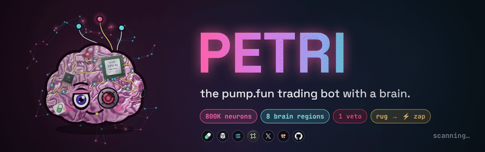


<p>


</p>

**Scientists grew 800,000 brain cells in a dish and taught them to play Pong.**<br/>
**So I grew one for pump.fun.**

[**⚡ Quickstart**](#-quickstart) · [**🧠 How it thinks**](#-how-it-thinks) · [**🛠 Build your own**](#-build-your-own-step-by-step) · [**🎨 Press kit**](#-press-kit--creatives) · [**❓ FAQ**](#-faq)

</div>

---

<table>
<tr>
<td width="46%">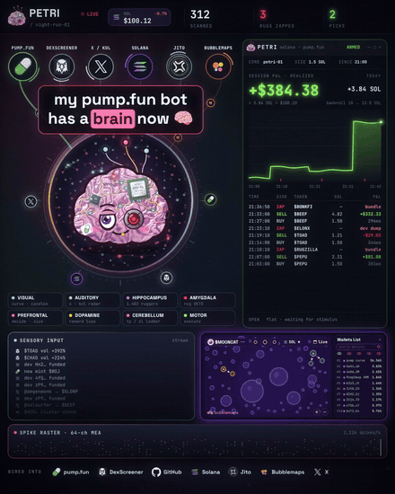</td>
<td>

### Meet PETRI 🧫

A cyber-brain with **two chips in its skull**, a cybernetic eye, a gold tooth and exactly one rule:

> **Touch a rug → get electrocuted.**

The brain hates pain. So it learns to never touch rugs again.

- 🔌 reads **6 feeds**: pump.fun · DexScreener · X · Solana RPC · Jito-window buys · holder clusters
- 🧠 thinks with **8 brain regions** — each one checks one thing
- ✕ **one red flag = ZAP.** no exceptions. no "but the chart looks good"
- 🐘 **never forgets a dev.** rugger wallets go into long-term memory (sqlite) forever
- 🪜 exits with a **TP ladder + trailing runner + hard stop**
- 🧪 **paper trading by default.** live mode is opt-in, burner wallet only

🎬 full video: [`assets/petri-demo.mp4`](assets/petri-demo.mp4)

</td>
</tr>
</table>

## 🎭 Moods

<div align="center">

| idle | thinking | **ZAP ⚡** | **SPIKE → BUY** | fried |
|:---:|:---:|:---:|:---:|:---:|
| 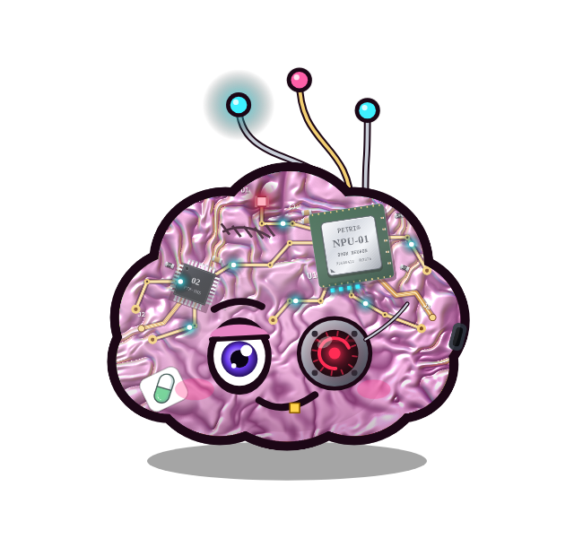 |  |  | 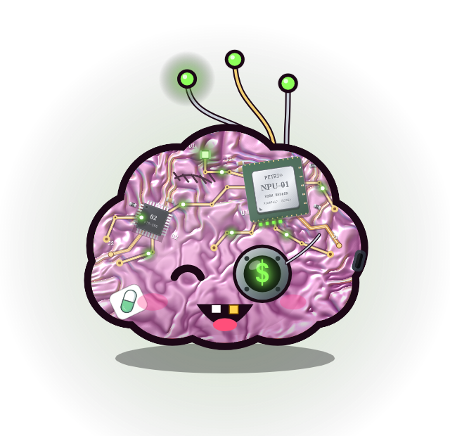 | 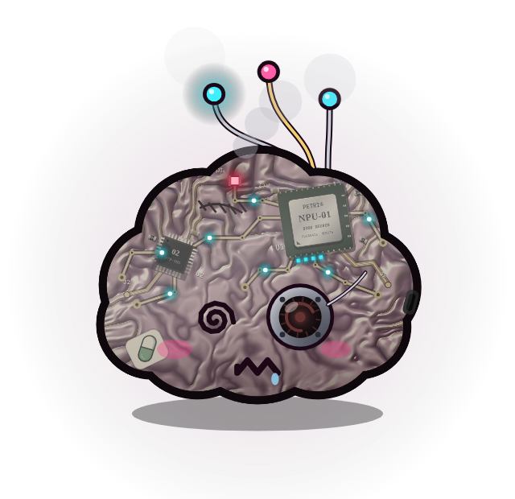 |
| waiting for stimulus | 8 regions firing | touched a rug. x-ray mode | 8/8 fired. `$` in the eye | post-zap. still smoking |

</div>

### 🔩 The hardware (yes, it's labelled)

| ref | part | what it does |
|---|---|---|
| **U1** | `PETRI® NPU-01 · 800K NEURON` | main neural processor under a metal IHS. runs the vote |
| **U2** | `02 · PTR-SNS` | sensory chip. turns feeds into stimuli |
| **D1** | status LED | red = scanning · green = in profit |
| **J1 / J2** | polyimide flex | neural threads into the cortex |
| **C1 / R1** | SMD 103 / 220 | decoupling. even brains need clean power |

---

## 🧠 How it thinks

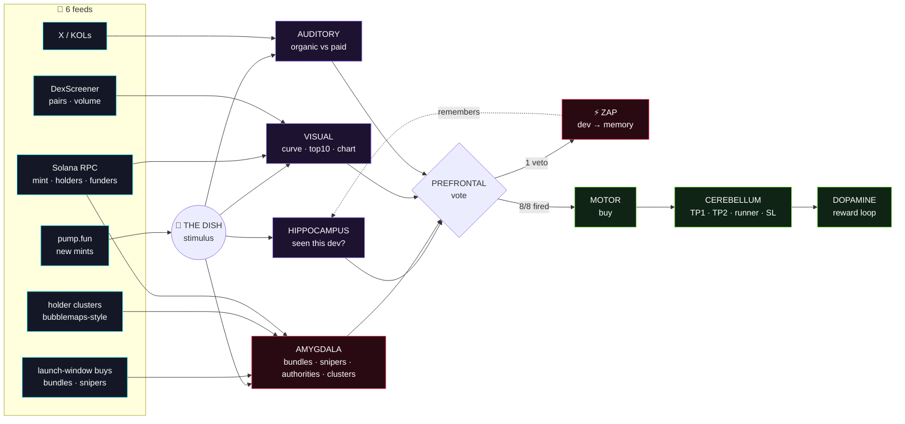

| region | checks | veto when |
|---|---|---|
| 🐘 **HIPPOCAMPUS** | dev wallet vs. rugger memory | dev rugged before → **instant zap**, zero RPC calls |
| 😱 **AMYGDALA** | `mint.authority`, `freeze.authority` | still LIVE (dev can print / freeze you) |
| 😱 **AMYGDALA** | `jito.bundle`, `snipers.block0` | ≥4 wallets ape the launch window and hold > 15% · snipers > 12% |
| 😱 **AMYGDALA** | `bubblemaps.cluster` | top holders share a funder holding > 20% (or dev-funded > 5%) |
| 👁 **VISUAL** | bonding curve %, top-10 share, DexScreener 5m | top-10 > 35% · price −40% in 5m |
| 👂 **AUDITORY** | X mentions | paid shills outnumber organic KOLs |
| 🧩 **PREFRONTAL** | vote + sizing | — it's the judge |
| 💊 **DOPAMINE** | PnL per signal | — it's the teacher |
| ⏱ **CEREBELLUM** | +100% sell 40% · +300% sell 40% · 20% trailing runner · −35% SL | — |
| 🦾 **MOTOR** | executes (paper or live) | — |

---

## ⚡ Quickstart

```bash
git clone https://github.com/MyWestLord/petri && cd petri
make install            # venv + deps + config.yaml + .env
make paper              # 🧪 paper trading. watch it zap rugs in your terminal
```

Live mode (you were warned — **burner wallet only**, size small):

```bash
pip install solders
# .env → PETRI_LIVE=1, PETRI_PRIVATE_KEY=<base58 burner>, PETRI_RPC_URL=<private rpc>
make live
```

What you'll see:

```text
PETRI online · PAPER · memory: 1402 ruggers

$MOONCAT 7xKq…pump
  ✓ HIPPOCAMPUS dev.wallet           clean · never seen
  ✕ AMYGDALA    jito.bundle          6 wallets · 31.4%
  ✕ AMYGDALA    snipers.block0       38.0% supply
  ✓ AMYGDALA    mint.authority       revoked
  ✕ AMYGDALA    bubblemaps.cluster   52.0% linked · dev-funded
  ✕ VISUAL      top10.share          71%
  ZAP ⚡ jito.bundle: 6 wallets · 31.4%, …  (dev memorised)

$GOOB 9mPd…pump
  ✓ HIPPOCAMPUS dev.wallet           clean · never seen
  ✓ AMYGDALA    jito.bundle          1 wallets · 2.1%
  ✓ AMYGDALA    snipers.block0       3.1% supply
  ✓ AMYGDALA    bubblemaps.cluster   4.0% linked
  ✓ VISUAL      top10.share          18%
  ✓ AUDITORY    kol.mentions         14 organic · 0 paid
  SPIKE → BUY 1.5 SOL (paper)
SELL $GOOB TP1 40% → +0.600 SOL  session +0.600
```

---

## 🛠 Build your own (step by step)

Want to build a bot like this from scratch? This is the whole recipe. Every step maps to a file.

<details>
<summary><b>1 · Get new mints the second they exist</b> → <code>petri/feeds/pumpportal.py</code></summary>

Connect to PumpPortal's public websocket and subscribe to `subscribeNewToken`. Every `create` message gives you the mint, the dev wallet and the starting curve state. Immediately `subscribeTokenTrade` for that mint so you see every buy/sell from second zero. Reconnect with backoff — websockets die.

</details>

<details>
<summary><b>2 · Wait ~6 seconds before judging</b> → <code>brain.py · OBSERVE_S</code></summary>

Bundles and snipers land in the first seconds. If you judge at t=0 you see nothing. If you wait 60s you're exit liquidity. 4–8s is the sweet spot on a good RPC.

</details>

<details>
<summary><b>3 · Memory first (it's free)</b> → <code>regions/hippocampus.py</code></summary>

Look up the dev in sqlite. Known rugger → zap without spending a single RPC call. Every zap writes the dev back. Over a few nights this becomes your most valuable asset.

</details>

<details>
<summary><b>4 · Authorities</b> → <code>regions/amygdala.py · authorities()</code></summary>

`getAccountInfo(mint, jsonParsed)` → `mintAuthority` / `freezeAuthority`. pump.fun mints revoke both, so a LIVE authority on a "pump" coin from DexScreener = honeypot / printer. Veto.

</details>

<details>
<summary><b>5 · Bundles & block-0 snipers</b> → <code>amygdala.launch_buys()</code></summary>

Take all buys inside the launch window. Many distinct wallets buying the same seconds and holding a big % = a Jito bundle by the dev's alts. Non-dev buys in that window = snipers. Tune `max_bundle_pct` / `max_sniper_pct`.

</details>

<details>
<summary><b>6 · Bubblemaps-style clusters</b> → <code>amygdala.clusters()</code></summary>

`getTokenLargestAccounts` → owner of each token account → oldest signature of each owner → who sent them their first SOL. Group holders by funder. One funder controlling 20%+ = one person pretending to be many. Dev-funded cluster = instant veto.

</details>

<details>
<summary><b>7 · Concentration, curve, chart</b> → <code>regions/visual.py</code></summary>

Top-10 share (skip #1, that's the curve/AMM vault), bonding curve % from `vSolInBondingCurve`, and once it migrates — DexScreener `latest/dex/tokens/{mint}` for 5m volume and price change.

</details>

<details>
<summary><b>8 · Real KOLs vs paid shills</b> → <code>regions/auditory.py</code></summary>

X recent search for the mint/ticker. Count organic mentions (optionally only from your KOL allow-list) vs. paid-looking posts (`#ad`, `promo`, `100x`, rocket spam). More paid than organic → veto.

</details>

<details>
<summary><b>9 · Vote</b> → <code>regions/prefrontal.py</code></summary>

Any `veto` → ZAP. Mostly green → BUY full size. A few `warn` → half size or skip. Keep it boring and strict — the edge is in what you *don't* buy.

</details>

<details>
<summary><b>10 · Exit like a machine</b> → <code>regions/cerebellum.py</code> + <code>motor.py</code></summary>

Ladder out: +100% sell 40%, +300% sell 40%, trail the last 20% with a 20% drawdown stop, hard SL at −35%. Live execution uses PumpPortal's local-transaction API: it returns an unsigned tx, you sign it locally with your burner keypair and send it through your own RPC. Your key never leaves your machine.

</details>

<details>
<summary><b>11 · Make it fast</b></summary>

Public RPC is fine for paper mode, not for live. Use a private RPC with good rate limits, run close to it (same region), and raise your priority fee in `motor.py` when the chain is busy.

</details>

---

## 🎨 Press kit / creatives

Free to use for memes, threads, banners. Tag the brain.

<div align="center">

| | | |
|:---:|:---:|:---:|
| 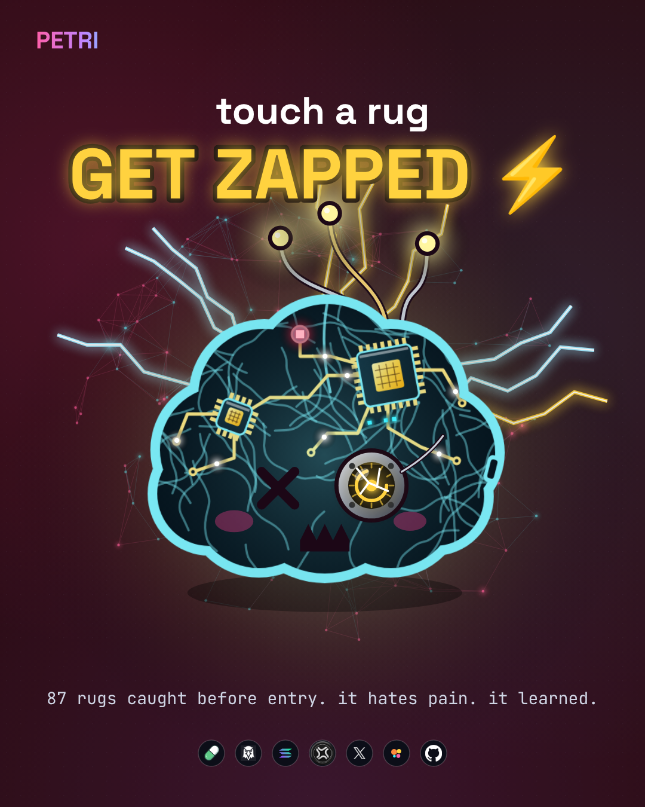 | 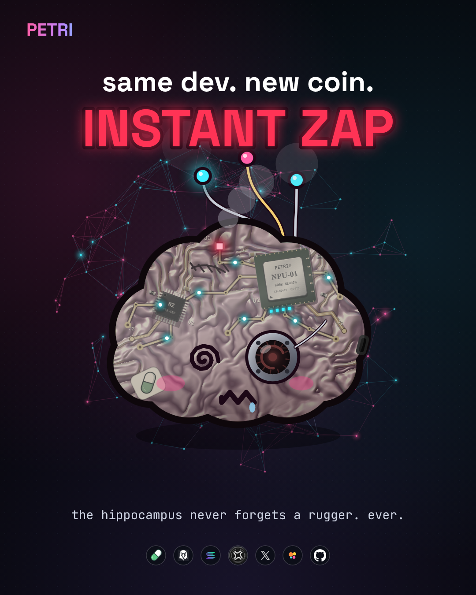 | 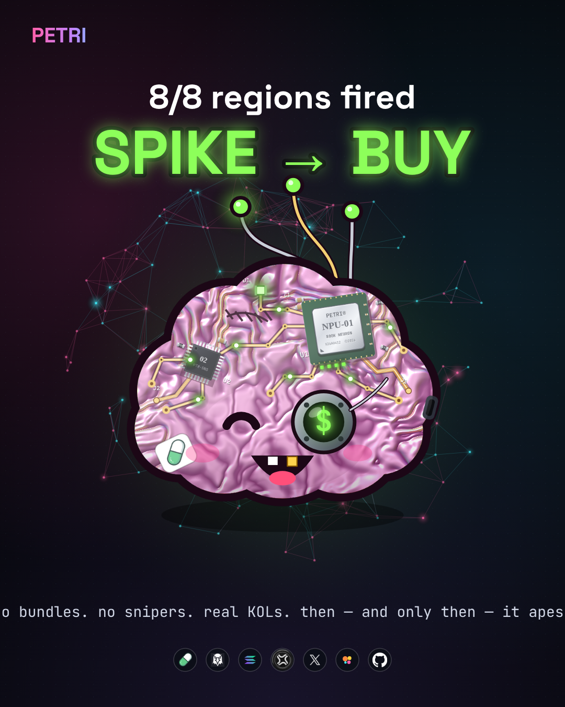 |
| `poster-zap.png` | `poster-memory.png` | `poster-spike.png` |
| 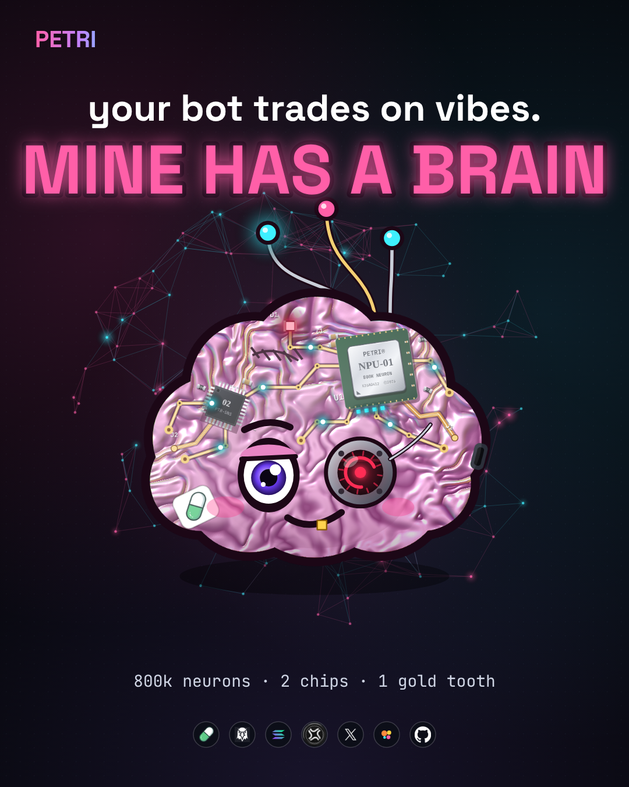 | 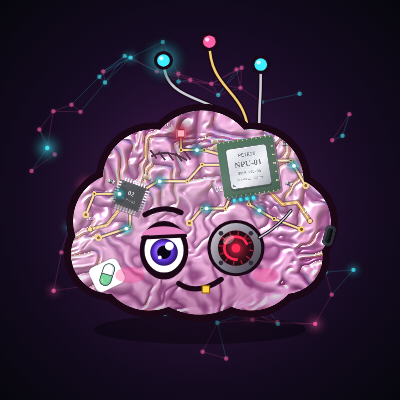 | 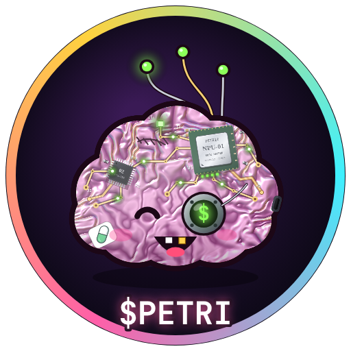 |
| `poster-vibes.png` | `avatar.png` (PFP) | `petri-coin.png` ($PETRI logo) |

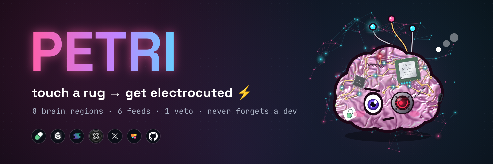<br/>
<sub><code>x-header.png</code> — 1500×500 X / Twitter header</sub>

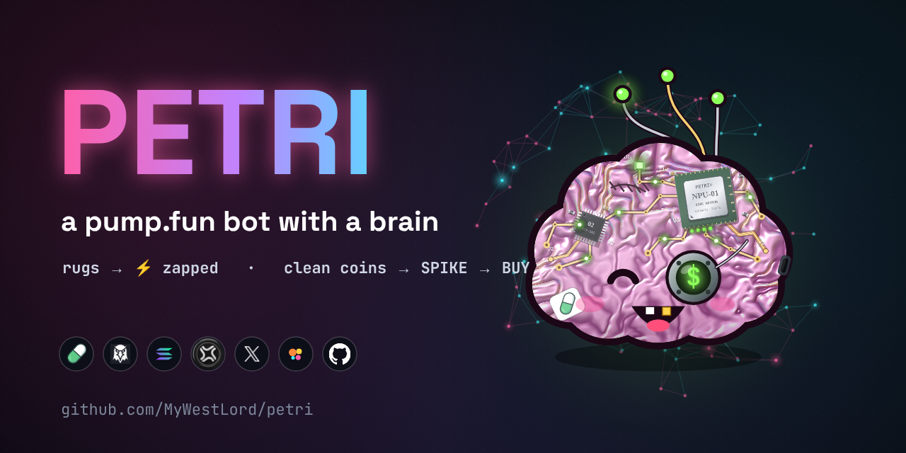<br/>
<sub><code>social-preview.png</code> — set it in repo Settings → Social preview</sub>

</div>

Transparent mascot PNGs: [`assets/mascot/`](assets/mascot) · demo video: [`assets/petri-demo.mp4`](assets/petri-demo.mp4)

---

## 🗺 Roadmap

- [x] 8 regions, veto voting, rugger memory
- [x] bundles · snipers · authorities · funder clusters
- [x] TP ladder + trailing runner + SL
- [x] paper mode by default
- [ ] web dashboard (the one from the video) with live PnL panel
- [ ] dopamine actually re-weighting thresholds from realized PnL
- [ ] Jito bundle submission for faster entries
- [ ] Telegram alerts: "ZAP ⚡ $XYZ — dev rugged 3x"

## ❓ FAQ

**Is it profitable?** Nobody can promise that — most pump.fun coins go to zero, and every number in the demo video is from a simulated paper run. PETRI's whole point is to *not buy* the obvious rugs. Run it in paper mode for a few nights and look at your own numbers before risking anything.

**Is it a real brain?** No. It's inspired by the 2022 *DishBrain* experiment (neurons in a dish learning Pong). PETRI's neurons are Python.

**Will it drain my wallet?** It never sees your key in paper mode. In live mode the key is read from your local `.env`, used only to sign locally, and should belong to a **burner** with only what you can afford to lose.

## ⚠️ Disclaimer

Educational / experimental software. Not financial advice. Memecoins are extremely risky and you can lose everything you put in. External APIs (PumpPortal, DexScreener, X, Solana RPC) change — verify endpoints and pump.fun curve parameters before going live. You are responsible for your trades and for following the laws where you live.

<div align="center">

---


**your bot trades on vibes. mine has a brain.**

⭐ star it if PETRI zapped a rug for you

</div>
